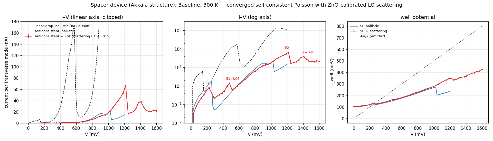
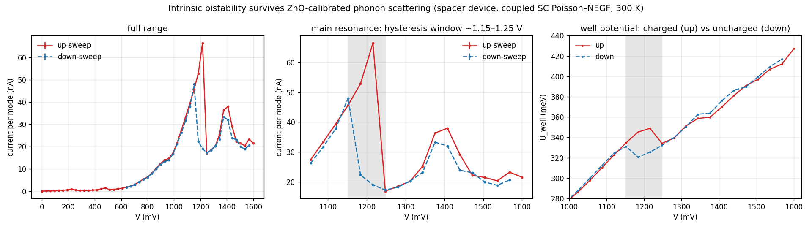
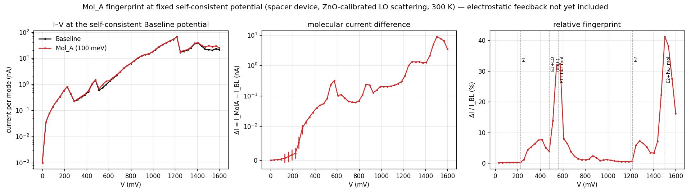

# Self-consistent Poisson–NEGF with phonon scattering — status

> **Audit correction (2026-10-12, after the runs below):** the numerical tables
> below describe the earlier stopping criterion and the approximate
> `windowed_single_mode_ratio` charge closure. They are not full transverse-SCBA
> validation. New code returns the same assembled charge used in Poisson and
> requires an unscreened equation defect, converged inner charge, and contact
> conservation. A fresh Baseline solve at 576 mV gives 0.9761 nA per mode per
> spin (old: 1.0065 nA), with a 9.56 µeV Poisson defect. See
> [the audit and machine-readable reports](../VALIDATION.md).
> Contact imbalance is not a statistical uncertainty: the prior sigma
> significance claims are withdrawn. The +30% Mol_A result remains evidence
> within the approximate model, not a validated device-level sensitivity.

*Branch `feature/poisson-scf`. Current as of 2026-10-12. This document supersedes
the conclusions of `POISSON_PEAK_SHIFT.md` and the Poisson-related items of
`IEEE_SENSORS_2026_REVISIONS.md`.*

**Question.** Does the ZnO/Mg₀.₃Zn₀.₇O RTD's IETS fingerprint survive realistic
electrostatics (self-consistent Poisson) and realistic electron–phonon
scattering? The submitted IEEE Sensors paper used a fixed linear potential drop
and no space charge; this work tests that assumption.

## Summary

- **All Poisson results before 2026-10-02 were unconverged** (stopped ~300 meV
  from the fixed point; current off by up to 100×). The "+64 mV forward shift"
  with spacers and the "−96 mV backward shift" without them are withdrawn.
- **Converged, with ZnO-calibrated LO scattering**, the spacer device's main NDR
  sits at **~1.22 V (66.5 nA per mode, PVR ≈ 4)** — against 0.58 V in the
  linear-drop model and 1.01 V for self-consistent ballistic transport.
- The main NDR is **intrinsically bistable** (≈1.15–1.25 V); the larger ballistic
  multistability found earlier was an artifact of scattering-free spacers.
- An **LO-phonon replica of E₁** at 480 mV is confirmed energy-resolved.
- **Mol_A (100 meV) has a strong fingerprint**: its vibron replica of E₁ adds
  **+30 % current at ~0.56 V, self-consistent within the approximate charge closure** (+32 % at fixed potential).
  A second, larger feature near 1.5 V is clear at fixed potential (+22–41 %) but
  its self-consistent solves do not yet converge.
- **Open:** Poisson convergence at low bias and near 1.5 V; device (transverse-
  integrated) current with scattering; Mol_B / Mol_AB discrimination.

All currents below are **per transverse mode** unless stated otherwise.

---

## 1. Model

| item | value |
|---|---|
| device | `ZnO_MgZnO_symmetric_spacer` (Akkala Table 3.1 structure): 30 nm n⁺ ZnO (N_D = 10²⁵ m⁻³) / **10 nm undoped spacer** / 2 nm Mg₀.₃Zn₀.₇O / 3 nm ZnO well / 2 nm Mg₀.₃Zn₀.₇O / 10 nm undoped spacer / 30 nm n⁺ ZnO |
| grid | a = 0.2 nm, N_p = 435; ΔE_c = 0.47 eV, m\* = 0.28 m₀, T = 300 K |
| Fermi level | E_F = 49.3 meV (bulk neutrality at N_D = 10²⁵ m⁻³) |
| electrostatics | 1-D Poisson; Dirichlet emitter, zero-field (Neumann) collector; deep terminals carry Thomas–Fermi charge; quantum-region density = transverse-integrated ballistic density on a 0.2 meV grid (converged: 0.2 / 0.05 / 0.02 meV agree to <0.01 %) |
| bulk LO phonon | ħω = 72 meV on **every undoped site** (spacers, barriers, well; doped leads excluded, Fix 7), **D² = 0.015 eV²/site** — see §3 |
| molecule | Mol_A: ħω = 100 meV, D₀² = 0.1 eV², Gaussian χ (σ = 0.3 nm) at the emitter barrier |
| scattering in Poisson | windowed SCBA on [V/2 − 0.25 eV, μ_L + 12 kT] at 0.5 meV, re-solved **inside every Poisson step**; density correction n_window(U)·(n_SCBA/n_ballistic − 1) |
| SCBA | recursive Green's functions (O(N_p) per energy), **linear mixing** (Anderson/DIIS gives wrong-sign currents at D² ≥ 0.01) |
| tolerances | sweeps: Poisson step 10⁻⁴ eV, inner SCBA 10⁻⁴, final current solve 10⁻⁵. Molecule comparisons: 10⁻⁵ / 10⁻⁵ / 10⁻⁷, paired from the same starting potential |

## 2. What was withdrawn, and why

| withdrawn | why | evidence |
|---|---|---|
| All self-consistent Poisson numbers before 2026-10-02, incl. the +64 mV (spacer) and −96 mV (no spacer) peak shifts and the Aug 5 molecule set | The damped predictor contracts at ~0.98/iteration; the 5 meV step criterion stopped ~300 meV from the fixed point | 640 mV: 40 iterations (step 4.5 meV) → U_well −138 meV, 204 nA; 400 iterations (step 0.02 meV) → +186 meV, 2.0 nA; 800 → +186 meV (ΔU 0.3 meV) |
| "Path dependence" of SC solutions (9.3 vs 90.7 nA at 432 mV) | Same slow drift, not bistability | as above |
| Ballistic SC multistability (784–1200 mV) | States fed only from the collector stay empty without scattering; spacer scattering fills them | 960 mV down branch +188 → +261 meV, 5.1 → 15.7 nA, onto the up branch (+260 meV, 15.7 nA) with D² = 0.001 in the spacers. Figure: `figures/ballistic_sc_multistability_withdrawn.png` |
| Anderson/DIIS mixing at D² ≥ 0.01 | Unconverged, wrong-sign currents | 320 mV: Anderson −0.08 nA, linear mixing +0.22 nA |
| Scattering corrections on a 2 meV grid | A ~1 meV-wide emitter-notch state at μ_L dominated, sampled erratically | one energy carried −18.6 % of a −15.9 % correction; at 0.5 meV the correction is a smooth few % |
| Outer-loop schemes for scattering in Poisson | Fixed offset lagged U near resonance (U_well jumping 270 ↔ 370 meV at 1.2 V); fixed ratio amplified errors (106 meV step) | replaced by the coupled scheme (§1) |
| "E₂ + LO replica" label at 1408 mV | Same elastic/assisted mix as the main peak (13 % / 42 % vs 16 % / 38 %) | likely E₂ re-alignment on the uncharged branch (not proven) |

Related corrections in the same period (non-Poisson): temperature sweeps held
E_F fixed (a hidden doping sweep; fixed-doping E_F = 38.3/37.3/34.0/20.0 meV at
10/77/150/300 K); the transverse E⊥ integration window was too wide by V/2
(8-node device current 28 % high at 10 K); the CLI SCBA defaults (10 iterations)
differ from production (100).

## 3. ZnO electron–phonon coupling

ZnO is a polar semiconductor whose dominant electron–phonon coupling is the
Fröhlich interaction (PRB 69, 113303). With ε∞ = 3.70–3.75, ε_s = 7.8–8.75,
m\* = 0.24–0.28 m₀ and ħω_LO = 71–73 meV (Özgür et al., JAP 98, 041301):
**α = 0.96–1.11**.

The model's local self-energy gives a broadening Γ = D²(N+1)·A_1D(E − ħω). Matching
it to the polar-optical emission rate ħW(E) = ħαω_LO(N+1)√(ħω/E)·sinh⁻¹√(E/ħω − 1):

| E above band edge | ħW (scattering time) | model at D² = 0.001 | D² needed |
|---|---|---|---|
| 77 meV | 20.6 meV (32 fs) | 8.2 meV | 0.0025 |
| 98 meV | 40.0 meV (17 fs) | 3.6 meV | 0.011 |
| 122 meV | 47.7 meV (14 fs) | 2.6 meV | 0.018 |
| 172 meV | 53.1 meV (12 fs) | 1.8 meV | 0.029 |

Production value **D² = 0.015 eV²/site**, 15× the 0.001 used before (which was
chosen for numerical stability). Caveats: Fröhlich coupling is long-range
(forward scattering), whereas the model's is local; free-carrier screening in the
leads and MgZnO alloy/interface modes are not modelled.

## 4. Results

### 4.1 Ballistic: self-consistent vs linear drop (same device and grids)

| | linear drop | self-consistent |
|---|---|---|
| E₁ NDR | 144 mV, 6.5 nA, PVR 13.7 | 256 mV, 1.85 nA, PVR 34.8 |
| E₂ NDR | 576 mV, 171 nA, PVR 16 | 1008 mV, 19.8 nA, PVR 3.3 |

The well already sits +101 meV above the lead band edge at V = 0 (electrons spill
into the undoped spacers) and follows only ~30 % of the bias (the collector
spacer depletes and carries most of it).

### 4.2 Coupled with scattering (D² = 0.015)

| feature | bias | current per mode | origin (energy-resolved, §4.3) |
|---|---|---|---|
| E₁ NDR | 224 → 288 mV | 0.811 → 0.223 nA | elastic through E₁ |
| E₁ + LO replica | 480 → 512 mV | 1.445 → 0.615 nA | LO-phonon replica of E₁ |
| main NDR | 1216 → 1248 mV | 66.5 → 16.9 nA | E₂, strongly phonon-assisted |
| secondary peak | 1408 mV | 38.0 nA | not a replica of the main peak |

All 51 up-sweep biases (0–1.6 V, 32 mV) and 30 down-sweep biases passed the earlier step-only Poisson criterion;
current conservation ±0.001–0.07 nA. Absolute currents carry a ~2 % error from
the Poisson tolerance (a tight re-solve at 960 mV moved U_well by 0.2 meV).

**Hysteresis.** Between 1152 and 1248 mV the two sweep directions settle on
different states: at 1184 / 1216 mV the up-sweep holds a charged, on-resonance
well (U_well 345 / 349 meV, 52.9 / 66.5 nA), the down-sweep an uncharged,
off-resonance one (321 / 326 meV, 22.3 / 19.0 nA). The secondary peak is mildly
hysteretic (4–6 meV, 8–18 %). Away from NDR the sweeps agree to <1 meV but differ
by 2–5 % in current — the numerical floor; ignore differences below ~5 %.

### 4.3 Feature identification (`run/replica_check.py`)

Where current enters (emitter) vs leaves (collector), relative to the resonance
energies from the transmission and the well's spectral weight:

| bias | E₁ | injected at E₁ | injected at E₁ + 72 meV |
|---|---|---|---|
| 224 mV | 205.0 meV | **89 %** | 4 % |
| 448 mV | 232.5 meV | 1 % | 76 % |
| 480 mV | 241.0 meV | 0 % | **80 %** |
| 512 mV | 241.0 meV | 0 % | 24 % |

At 448–480 mV E₁ lies at the emitter band edge, so electrons enter one LO phonon
above it and emit — the replica — and the channel shuts off past 480 mV.
At 1216 and 1408 mV: 16 % / 13 % injected at E₂, 38 % / 42 % one LO above it.

### 4.4 Mol_A fingerprint at fixed potential (`run/fixedU_fingerprint.py`)

Baseline and Mol_A solved on the same converged Baseline potential (SCBA final
tolerance 10⁻⁷):

| bias | ΔI / I_Baseline | significance |
|---|---|---|
| ≤ 224 mV | +0.2–0.3 % | not resolved |
| 256–416 mV (E₁ valley) | +1.2 → +7.7 % | larger than contact imbalance; total numerical uncertainty unquantified |
| **544–576 mV** | **+31.7 %, +32.4 %** (ΔI ≈ 0.3 nA) | sigma interpretation withdrawn; grid/model uncertainty unquantified |
| 608–1216 mV | +0.5–8 % | |
| 1248–1440 mV | +3–7 % | |
| **1472–1568 mV** | **+22 → +41 → +28 %** (ΔI up to 8.8 nA) | |

At 576 mV, **81 % of the current Mol_A adds enters within 6 meV of E₁ + 100 meV**
(none at +72 meV): a molecular-vibron replica of E₁. At 1504 mV ~52 % of it enters
100 meV above the two well states near E₂. In principle the bias spacing between
the LO replica (480 mV) and the molecular replica (~560 mV) reads out ħω_mol.

### 4.5 Electrostatic feedback (`run/feedback_check.py`)

Paired, self-consistent within the approximate charge closure Baseline and Mol_A solves at tight tolerances:

| bias | ΔI self-consistent | ΔI fixed potential | ΔU_well from molecule | |
|---|---|---|---|---|
| 544 mV | +26.2 % | +31.7 % | +1.18 meV | converged |
| 576 mV | **+30.3 %** | +32.4 % | +1.79 meV | converged |
| 608 mV | +6.8 % | +8.0 % | +0.36 meV | converged |
| 960 mV | +0.93 % | +1.05 % | +0.19 meV | converged |
| 320 mV | +6.7 % | +5.4 % | −0.69 meV | Poisson not converged |
| 1472 / 1504 / 1536 mV | +41 / +73 / +51 % | +22 / +41 / +38 % | −4.1 / −6.1 / −0.4 meV | Poisson not converged |

**The approximate model retains an E₁ molecular contribution** — the molecule's own
charge trims it by 10–20 % of its size. Near 1.5 V the self-consistent numbers
are indicative only.

## 5. Open issues

1. **Poisson convergence.** The damped predictor stalls (~0.15–0.8 meV steps) at
   low bias and near 1.5 V. Anderson acceleration on U converged faster at 960 mV
   but 0.33 meV off; full Newton with the exact ballistic Jacobian
   (`core.poisson.ballistic_density_jacobian`, validated against finite
   differences to 10⁻⁹) agrees with the plain predictor to 0.03 meV at 960 mV but
   is unstable at 32 mV. Both are opt-in and experimental.
2. **Device current with scattering.** Device currents here are ballistic device
   currents scaled by the per-mode SCBA/ballistic ratio — indicative only.
3. **Discrimination.** Mol_B (180 meV) and Mol_AB not yet run; Mol_B's replica
   should sit at a bias set by its larger ħω.
4. Bias resolution: 32 mV steps place peaks to ±16 mV; a 16 mV pass near the main
   peak and the replicas is pending.
5. Temperature dependence with scattering; sensitivity to D²; local vs Fröhlich
   coupling.
6. **Data are not backed up**: `results/` is gitignored (the figures above are
   copied into `docs/figures/`).

## 6. Reproducing

| result | command | output |
|---|---|---|
| ballistic SC up/down | `python -u run/bistability_check.py up 0.0 1.2 0.016` then `down …` | `results/2026-10-02/bistability_spacer.npz` |
| ballistic linear-drop reference | computed inline from the above (banded transmission on the linear profile) | `results/2026-10-02/spacer_linear_vs_sc_ballistic.npz` |
| coupled I–V, up and down | `python -u run/sc_coupled_sweep.py --mol Baseline --v1 1.6 --down-to 0.64` | `results/2026-10-07/sc_coupled_D20.015_{up,down}.npz` |
| feature identification | `python -u run/replica_check.py` | printed |
| Mol_A fingerprint (fixed U) | `python -u run/fixedU_fingerprint.py Mol_A 0.015` | `results/2026-10-07/fixedU_fingerprint_D20.015_Mol_A.npz` |
| feedback check | `python -u run/feedback_check.py Mol_A 0.015` | `results/2026-10-07/feedback_check_D20.015_Mol_A.npz` |

Run on AC power with the lid open (sleep froze several runs for hours);
`caffeinate -i -w <pid>` prevents idle sleep. A bias takes ~1–3 min (coupled,
default tolerances) to ~3–10 min (tight, paired) on AC.

**Performance work that made this feasible:** RGF SCBA (`method="rgf"`, 217×
faster than dense at N_p = 435, identical to 10⁻¹³); RGF density/transmission
(5–7×); chunked low-memory SCBA (1.85 GB instead of ~11 GB); skipping the
in-loop SCBA when the density has its own grid (10×).
